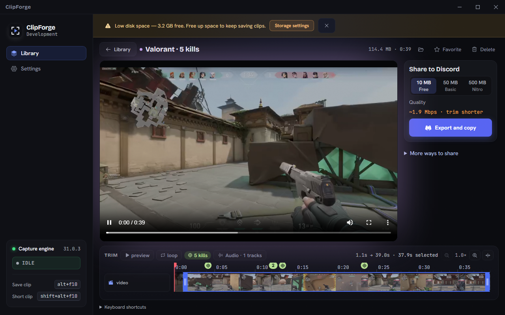
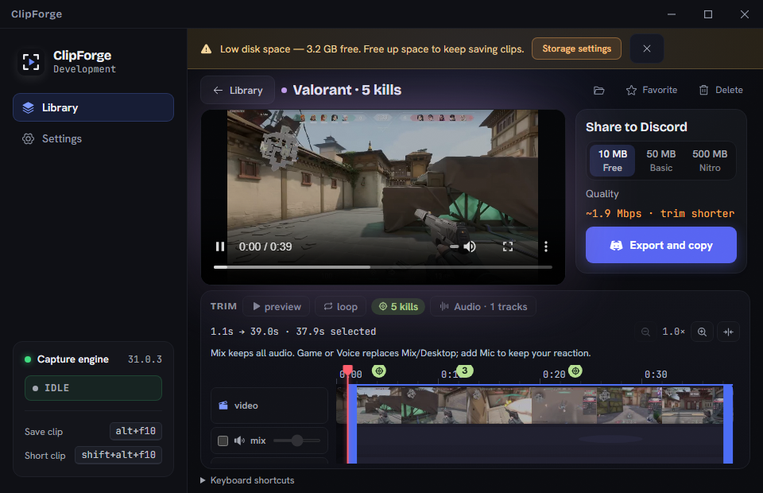

# Sequential review fixes — completion evidence

25 October 2026. Implemented the actionable findings from the seven sequential skill reports, preserving the existing game-focused desktop design. Verification completed before release preparation for v0.1.41.

## Findings resolved

| Review issue | Implemented correction | Verification |
|---|---|---|
| Small footage/default and minimum layout | Bounded editor grid, flexible player, fixed export rail, optional internally scrolling audio mixer; compact two-row trim tools | Six size/mixer combinations, low-disk banner visible; no editor scroll overflow |
| Tiny faint timeline ruler | 12px labels and brighter text | Screenshots at both native sizes |
| Watched-game newline loss | Local raw draft; normalize only on save/blur | Browser Enter + executable row retained |
| Copy menu loses focus | Restore surviving trigger after action, preserve destination focus | Keyboard Copy returns focus to card menu |
| Reduced-motion gaps and repeated entrances | Reactive preference; no hover video/edge/switch travel under reduce; remove menu/Settings entrances and keyboard press scale | Computed animations/transforms and video mounting checks |
| Settings feedback and recovery | Saving/saved/error/retry status; queued field patches rebased on current backend; canonical reload; local text drafts; reset clears failed patches | Failure injection, retry, blur persistence, delayed-save draft race, reset followed by unrelated edit; unit tests |
| Setup/backup failures | Actionable local alerts, retry guidance and optional technical details | Backup failure injection; setup source/build checks |
| Drag-only montage ordering | Earlier/later buttons, Ctrl+arrow support, announcements/focus | Browser order assertions and immutable reorder tests |
| Headings/native theme/navigation/form metadata | Editor H1, Settings H2s, skip link, dark color scheme/theme-color; form names/spellcheck; contained dialog scroll | Browser heading/focus/theme assertions; source checks |
| Overprominent healthy diagnostics/navigation | Healthy detail collapsed; health after main settings; four grouped destinations | All nine destinations focus their headings at 1280×800 and 960×620 |
| Nested chrome/tokens | Flat toggle rows; consolidated semantic color/type/space/radius/motion roles | Rendered inspection and build |
| Storage warning wraps at minimum | Shorter copy and no-wrap action | Banner present in all six editor screenshots |
| Second pointer interrupts trim | Ignore additional contacts; explicit capture release | Actual-controller ownership/cancel/restart/commit tests |
| Per-frame range width writes | Transform-scaled selection fill; handles remain exact | Browser endpoint bounds within 1px before/after zoom |
| Enlarged text/long title | Title truncation, export label/button wrapping, sidebar hotkey wrapping | Doubled type-role tokens and long title at both native sizes; export and trim reachable |

## Layout measurements

These are player element frames, with contain-fit video inside; they are not claims that letterboxed pixels are footage. Before the review, five-track footage was approximately 267×150.

| Window | Mixer closed | Mixer open | Editor overflow |
|---|---|---|---|
| Default 1280×800 | 754×459 | 754×359 | None |
| Minimum 960×620 | 458×283 | 458×220 | None |
| Additional 1440×900 | 914×559 | 914×439 | None |

At minimum size, enabled Mic volume is reachable by keyboard through the mixer's own scroll area; the outer editor stays at scrollTop 0. Expanding secondary sharing uses the export rail's internal scroll. Trim controls remain in the window. The layout check includes a 3.2 GB low-space banner.

## Automated and browser results

- Final `npm run build`: passed (TypeScript + Vite production bundle).
- Final `npm test`: 26 passed, zero failures.
- `cargo test --manifest-path src-tauri/Cargo.toml --lib`: 40 passed, zero failures, five existing environment-dependent ignored tests.
- `git diff --check`: passed.
- Browser checks: layout matrix, expanded sharing, mixer focus/volume, zoom/range geometry, watched drafts/menu focus, montage keys/buttons, skip link/headings/native theme, grouped Settings navigation, blur persistence, reduced motion, injected save/backup errors, retry and reset recovery. No application console errors in the final browser sessions; only React development-tool info messages.
- Independent source reviewer found persistence baseline/reset/draft races during implementation. All were fixed, followed by browser regressions and a final narrow source review with no remaining important defects.
- Impeccable mechanical source scan: one warning, the existing documented rare onboarding-dot width transition. Retained deliberately; not a new defect or a measured performance problem.

## Performance evidence and limits

A 40-step real trim drag was profiled through Chromium Performance metrics with preview paused. Baseline: 19 layouts / 6.400ms layout / 16.490ms style / 137.140ms task. Transform version: 20 layouts / 6.702ms layout / 18.660ms style / 143.109ms task. This does not establish a performance speedup. The range no longer writes width each frame, but readout and other work still cause layout. Precision and endpoint alignment were verified; no dropped-frame or GPU improvement is claimed.

Browser tests use the preview's fixture backend and a real local video. Real OBS capture, native WebView2 rendering, native filesystem export, network uploads, physical multitouch, GPU traces and NVDA were not exercised. Five Rust tests require additional local/live dependencies. The text test doubles typography tokens; it is not a full operating-system scaling certification. No landing-page redesign was imposed by the inapplicable Design Taste skill.

Evidence scripts/screenshots are retained under `evidence/`; browser CLI/config and preview-server setup are environment-specific. Temporary test sessions and the preview server are closed after verification.
